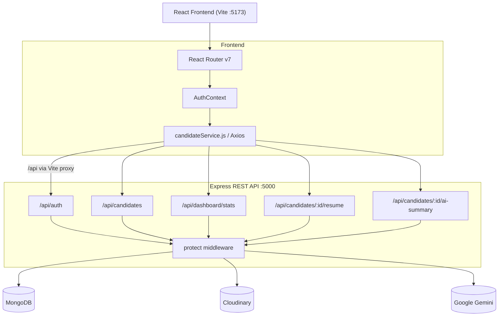

# HireFlow — Mini Applicant Tracking System

HireFlow is a full-stack recruitment management application that helps recruiters manage candidates, track hiring progress, search and filter records, and review pipeline metrics — all behind a secure authentication layer.

The goal was not to produce a static dashboard with placeholder data, but to build a functional, end-to-end ATS: one where every metric on the dashboard is computed from real MongoDB data, every candidate operation persists to a database, and every protected route actually rejects unauthenticated requests.

---

## Table of Contents

1. [Features](#features)
2. [Technology Stack](#technology-stack)
3. [Architecture](#architecture)
4. [Candidate Lifecycle](#candidate-lifecycle)
5. [Engineering and Product Decisions](#engineering-and-product-decisions)
6. [Development Time and Attention to Detail](#development-time-and-attention-to-detail)
7. [Project Structure](#project-structure)
8. [Installation and Local Development](#installation-and-local-development)
9. [Environment Variables](#environment-variables)
10. [API Reference](#api-reference)
11. [Security](#security)
12. [Testing](#testing)
13. [Known Limitations and Future Improvements](#known-limitations-and-future-improvements)
14. [Deployment](#deployment)

---

## Features

| # | Feature | Status |
|---|---------|--------|
| 1 | Recruiter registration and login | Implemented |
| 2 | JWT authentication via HTTP-only cookies | Implemented |
| 3 | Protected frontend routes (ProtectedRoute / PublicOnlyRoute) | Implemented |
| 4 | Candidate creation, editing, and deletion | Implemented |
| 5 | Candidate list with sortable columns | Implemented |
| 6 | Search by name, email, or position | Implemented |
| 7 | Filter by hiring stage and position | Implemented |
| 8 | Server-side pagination | Implemented |
| 9 | Candidate detail drawer | Implemented |
| 10 | Six-stage hiring pipeline (kanban-style view) | Implemented |
| 11 | Stage update from table, drawer, and pipeline card | Implemented |
| 12 | Dashboard with live statistics from MongoDB | Implemented |
| 13 | Stage distribution bar chart (Recharts) | Implemented |
| 14 | Recent candidates list on dashboard | Implemented |
| 15 | Resume upload (PDF, max 5 MB, stored on Cloudinary) | Implemented |
| 16 | Resume view (inline — backend-proxied blob stream) | Implemented |
| 17 | Resume download (Content-Disposition: attachment) | Implemented |
| 18 | Resume delete (removes from Cloudinary and clears metadata) | Implemented |
| 19 | AI-generated candidate summary (Google Gemini) | Implemented |
| 20 | Loading, empty, and error states throughout the UI | Implemented |
| 21 | Toast notifications (Sonner) | Implemented |
| 22 | Confirm dialog for destructive operations | Implemented |
| 23 | Seed script for sample data | Implemented |

**Resume streaming note:** The backend fetches the PDF from Cloudinary server-side using a signed private URL and pipes the bytes to the client with `Content-Type: application/pdf`. Cloudinary `private` assets cannot be opened directly by the browser. Both the inline view and attachment download flows have been manually verified. The Vite dev-server proxy handles the download request so the auth cookie is sent same-origin without blob-URL complications.

**AI summary note:** Summaries are generated on demand via the Gemini API. They are **not persisted** — they live in React state and are cleared when the drawer closes or the candidate changes. This is intentional (see Decision 8 below).

---

## Technology Stack

### Frontend

| Library | Version | Purpose |
|---------|---------|---------|
| React | ^19.2.8 | UI component framework |
| Vite | ^8.3.0 | Dev server and build tool |
| React Router DOM | ^7.18.4 | Client-side routing and protected routes |
| Tailwind CSS | ^3.4.19 | Utility-first styling |
| @tailwindcss/forms | ^0.5.11 | Form element base styles |
| Axios | ^1.20.0 | HTTP client with withCredentials for cookie auth |
| Lucide React | ^1.59.0 | Icon library |
| Recharts | ^3.10.1 | Bar chart for stage distribution |
| Sonner | ^2.0.8 | Toast notification system |
| clsx | ^2.1.1 | Conditional class name utility |
| oxlint | ^1.81.0 | Linter (dev dependency) |

Fonts: Inter (400, 500, 600, 700) loaded from Google Fonts via `index.css`.

### Backend

| Library | Version | Purpose |
|---------|---------|---------|
| Node.js | 20+ | Runtime (built-in fetch required for resume streaming) |
| Express | ^4.19.2 | REST API framework |
| Mongoose | ^9.11.2 | MongoDB ODM with schema validation |
| bcryptjs | ^3.0.3 | Password hashing (salt rounds: 12) |
| jsonwebtoken | ^9.0.3 | JWT signing and verification |
| cookie-parser | ^1.4.7 | Reads HTTP-only auth cookie |
| cors | ^2.8.5 | Credentialed cross-origin requests |
| helmet | ^8.3.0 | Security response headers |
| dotenv | ^16.4.5 | Environment variable loading |
| express-rate-limit | ^8.7.1 | Rate limiting on auth and AI routes |
| multer | ^2.4.0 | Multipart file upload (memory storage) |

### External Services

| Service | SDK | Purpose |
|---------|-----|---------|
| MongoDB Atlas | mongoose ^9.11.2 | Persistent candidate and recruiter data |
| Cloudinary | cloudinary ^2.11.0 | Private PDF resume storage and signed URL delivery |
| Google Gemini | @google/genai ^2.30.0 | On-demand AI candidate summaries |

---

## Architecture



### Key design points

- **Strict frontend/backend separation.** The frontend never accesses MongoDB or Cloudinary directly. All secrets stay server-side.
- **Vite proxy in development.** All `/api` requests are proxied to `http://localhost:5000`, making them same-origin. This is why HTTP-only cookies work automatically and why the download anchor approach needs no blob-URL workaround in development.
- **HTTP-only cookie auth.** The JWT is stored in a `httpOnly; SameSite=Lax` cookie (dev) or `httpOnly; SameSite=None; Secure` (prod). JavaScript cannot read it, preventing XSS-based token theft.
- **Resume streaming.** The backend generates a 120-second Cloudinary signed URL, fetches the PDF server-side via Node 20 built-in `fetch`, and pipes the bytes to the client with `Content-Type: application/pdf`. Cloudinary private assets are never exposed directly to the browser.
- **AI summaries do not persist.** Summaries live in React component state only and are cleared when the drawer closes. Nothing is written to MongoDB.

---

## Candidate Lifecycle

```
Applied -> Screening -> Interview -> Offer -> Hired
                                           -> Rejected (from any stage)
```

| Stage | Meaning |
|-------|---------|
| Applied | Submitted; initial review pending |
| Screening | Profile review or phone screen in progress |
| Interview | Candidate invited for technical or panel interviews |
| Offer | Offer extended; awaiting candidate response |
| Hired | Candidate accepted and joined |
| Rejected | Not selected at this stage |

Stage updates can be made from three places: the dropdown in the candidates table, the stage selector in the candidate detail drawer, and the dropdown on each pipeline card. All updates are `PATCH /api/candidates/:id` calls that write immediately to MongoDB.

The Dashboard reflects live MongoDB counts: total candidates, active candidates (not Hired or Rejected), in Interview, hired this calendar month, a stage distribution chart, and the six most recently applied candidates.

---

## Engineering and Product Decisions

### Decision 1: MERN Stack

I chose the MERN stack because I wanted to build a genuinely full-stack application rather than a frontend prototype backed by a JSON file. React, Express, Node.js, and MongoDB all use JavaScript, which meant I could maintain consistent mental context across the stack — from schema validation in Mongoose to route logic in Express to state management in React — without context-switching between languages. It also allowed me to build the authentication system, API, and database layer as a coherent unit.

### Decision 2: Authentication Was a Priority

An ATS stores candidate contact information, hiring decisions, and recruiter notes. A publicly accessible CRUD dashboard would have been unrealistic for anything resembling a production tool. I implemented JWT authentication with HTTP-only cookies rather than `localStorage` because a cookie-based approach prevents JavaScript from reading or exfiltrating the token. The `protect` middleware verifies the JWT and re-queries MongoDB on every request, so deleted accounts are rejected immediately rather than being served stale cached data.

The frontend enforces the same boundary: `ProtectedRoute` redirects unauthenticated visitors to `/login`, and `PublicOnlyRoute` redirects authenticated users away from the auth pages. Auth state is established on mount via a silent `GET /api/auth/me` call.

### Decision 3: A Distinctive, Professional UI

The initial iteration of the UI was too generic. I chose to invest time in a cohesive design system: Inter as the base typeface, a consistent deep-navy (`#1a2f54`) brand accent for avatars and focus states, a warm off-white (`#f5f6f8`) background, and a reusable component layer in `index.css` (`btn`, `input`, `card`, `badge`, `select`) so every interactive element shares the same visual language. The goal was for HireFlow to feel like a real recruitment product, not a collection of stacked components.

### Decision 4: Iterative Development and Testing

I built the application in phases and tested each before moving to the next: foundation and design system, authentication, candidate management, dashboard analytics, pipeline view, resume management, and AI summaries. This approach let me catch issues — such as the Cloudinary `Content-Type` problem for raw assets and the Gemini multi-part response truncation — before they accumulated into harder-to-debug compound failures.

### Decision 5: Live Database-Backed Analytics

The dashboard computes every metric from real MongoDB aggregation queries run in parallel via `Promise.all`. There are no hardcoded values, no mock statistics, and no fallback fixtures. If no candidates exist, the metrics show zero.

### Decision 6: Six Explicit Hiring Stages

I chose a linear six-stage pipeline because it maps to a recognizable real-world recruitment workflow. Named stages make the pipeline view self-explanatory, give the dashboard chart meaningful categories, and enable stage filters on the candidates page. MongoDB's `enum` validation on the `stage` field ensures no record enters an undefined state through the API.

### Decision 7: Resume Uploads via Cloudinary Private Storage

I chose Cloudinary as the external file store to avoid bloating MongoDB with binary data. I stored resumes as `type: 'private'` assets so they are not publicly accessible via URL — a leaked Cloudinary public ID cannot be used to access the file without also compromising the API secret. The backend streams the PDF bytes to the client on every view or download request, setting `Content-Type: application/pdf` explicitly because Cloudinary serves raw assets as `application/octet-stream` without format metadata.

PDF validation is layered: Multer checks the declared MIME type, and the route handler independently checks the first four bytes of the buffer for the `%PDF` magic signature before sending anything to Cloudinary.

### Decision 8: AI Candidate Summary

I chose on-demand generation rather than auto-generating a summary every time a profile opens. This gives the recruiter explicit control, avoids unnecessary Gemini API calls, and makes the generation intent clear through a visible button.

The prompt sends only professional fields to Gemini: `position`, `experience`, `skills`, `stage`, and `notes`. Name, email, and phone are excluded to keep PII out of third-party API calls. Recruiter notes are isolated below the system instructions with a delimiter to prevent prompt injection.

The backend enforces a rate limit of 10 requests per IP per minute. The frontend extends the Axios timeout to 50 seconds for this endpoint, above the backend's 45-second Gemini provider timeout.

AI-generated summaries can contain inaccuracies and should be reviewed by the recruiter. The system does not parse uploaded resumes — it summarizes only the structured data fields stored in MongoDB.

### Decision 9: Scope Focus

I prioritized the core ATS workflows — candidate management, pipeline tracking, dashboard metrics, authentication, and document management — over adding experimental features. A reliable, fully functional core is more useful than a wider surface area of partially working features.

---

## Development Time and Attention to Detail

The assignment estimated approximately six hours of effort. I spent more than that.

I want to be transparent about why: I am a perfectionist about the details, and I find it difficult to submit work I am not satisfied with. Once the foundation was in place, I kept noticing areas where the experience could be meaningfully improved — a UI element that was inconsistent with the rest, an integration behavior that worked but was fragile, a prompt that produced truncated output. Rather than stopping at the first working version, I chose to go back and fix those things.

The additional time went into: iterating on the visual design until it felt coherent rather than assembled, working through the resume streaming architecture (returning a Cloudinary URL directly failed because private assets require signed access and Cloudinary does not set `Content-Type` for raw resources), debugging the Gemini multi-part response truncation, improving the system prompt to produce structured 4-5 sentence summaries, and writing this documentation.

I do not consider this poor time management. I consider it the difference between shipping something that works and shipping something I am proud of. I am aware that deadlines are real constraints, and in a production setting I would weigh scope against time more explicitly. For this assignment, I chose completeness.

---

## Project Structure

```
ats-system/
  .gitignore
  README.md

  frontend/
    package.json
    vite.config.js              Vite dev server with /api proxy to :5000
    src/
      main.jsx                  React entry point
      App.jsx                   Router, AuthProvider, Toaster, route definitions
      index.css                 Tailwind base + component layer (btn, input, card...)
      context/
        AuthContext.jsx         Session state, login, register, logout
      components/
        auth/
          ProtectedRoute.jsx    Redirects unauthenticated users to /login
          PublicOnlyRoute.jsx   Redirects authenticated users from auth pages
        layout/
          AppLayout.jsx         App shell with Sidebar and Outlet
          Sidebar.jsx           Navigation links
          Header.jsx            Top bar with recruiter name and logout
        candidates/
          CandidateDetailDrawer.jsx   Slide-in panel: profile, resume, AI summary
          CandidateModal.jsx          Create/edit form modal
        dashboard/
          StageDistributionChart.jsx  Bar chart (Recharts)
          ApplicationTrendChart.jsx   Trend chart (Recharts)
          RecentCandidatesTable.jsx   Six most recent candidates
        ConfirmDialog.jsx       Reusable destructive-action dialog
        MetricCard.jsx          Dashboard stat card
        PageHeading.jsx         Page title with optional action button
        StageBadge.jsx          Color-coded stage pill
      pages/
        DashboardPage.jsx       Metrics and charts
        CandidatesPage.jsx      Table, search, filters, sort, pagination
        PipelinePage.jsx        Kanban-style pipeline board
        auth/
          LoginPage.jsx
          RegisterPage.jsx
      services/
        apiClient.js            Axios instance: baseURL, withCredentials, interceptors
        candidateService.js     All API calls: CRUD, resume ops, AI summary, dashboard
      lib/
        utils.js                formatDate, getInitials, stageBadgeClass
        mockData.js             Unused stub from early development

  backend/
    package.json
    .env.example
    src/
      server.js                 Express bootstrap, MongoDB connection, route mounting
      app.js                    Minimal app export
      middleware/
        auth.js                 protect() — reads JWT from cookie, attaches req.recruiter
      models/
        Recruiter.js            Schema: name, email, hashed password (select:false)
        Candidate.js            Schema: profile fields + resume metadata sub-document
      routes/
        health.js               GET /api/health
        auth.js                 register, login, logout, /me
        candidates.js           Full CRUD + search/filter/pagination
        dashboard.js            GET /api/dashboard/stats
        resume.js               POST/GET/DELETE /api/candidates/:id/resume
        aiSummary.js            POST /api/candidates/:id/ai-summary
      lib/
        cloudinary.js           Cloudinary v2 SDK config (credentials from env only)
        upload.js               Multer memory storage + MIME filter + magic-byte check
    scripts/
      seed.js                   Populates MongoDB with 12 sample candidates
      test-auth.mjs             Verifies protected endpoints reject unauthenticated requests
```

---

## Installation and Local Development

### Prerequisites

- Node.js 20 or later (Node 20 built-in `fetch` is used in the resume streaming route)
- MongoDB database (MongoDB Atlas free tier works)
- Cloudinary account (free tier) — required for resume upload, view, and download
- Google Gemini API key (free via [Google AI Studio](https://aistudio.google.com/app/apikey)) — required for AI summaries

### 1. Clone the repository

```bash
git clone <repository-url>
cd ats-system
```

### 2. Set up the backend

```bash
cd backend
cp .env.example .env
# Edit .env and fill in real values (see Environment Variables)
npm install
npm run dev
# API listening on http://localhost:5000
```

The `dev` script uses Node's `--watch` flag for auto-restart. Use `npm start` to run without it.

Seed sample candidates (optional):

```bash
npm run seed          # insert 12 candidates (skips if already seeded)
npm run seed:force    # clear and re-seed
```

### 3. Set up the frontend

```bash
cd ../frontend
npm install
npm run dev
# App available at http://localhost:5173
```

The Vite dev server proxies `/api` to `http://localhost:5000`. No additional URL configuration is needed for local development.

### 4. Create a recruiter account

Open `http://localhost:5173` and register from the Register page.

### 5. Production build

```bash
cd frontend
npm run build     # outputs to frontend/dist/
npm run preview   # serve the production build locally
```

---

## Environment Variables

### Backend — backend/.env

| Variable | Required | Default | Description |
|----------|----------|---------|-------------|
| `PORT` | No | `5000` | Port the Express server listens on |
| `NODE_ENV` | No | `development` | Set `production` for secure cookies and terse error messages |
| `CLIENT_URL` | No | `http://localhost:5173` | Comma-separated list of allowed CORS origins |
| `MONGODB_URI` | Yes | — | Full MongoDB connection string |
| `JWT_SECRET` | Yes | — | Random string, minimum 64 characters |
| `JWT_EXPIRES_IN` | No | `7d` | JWT expiry (e.g. `7d`, `24h`) |
| `CLOUDINARY_CLOUD_NAME` | Yes* | — | Cloudinary cloud name |
| `CLOUDINARY_API_KEY` | Yes* | — | Cloudinary API key |
| `CLOUDINARY_API_SECRET` | Yes* | — | Cloudinary API secret |
| `GEMINI_API_KEY` | Yes* | — | Google Gemini API key |
| `GEMINI_MODEL` | No | `gemini-3.8-flash` | Gemini model name |

*Required for resume and AI summary features respectively. The application starts without them but those endpoints return `503` until credentials are set.

Generate a secure JWT secret:
```bash
node -e "console.log(require('crypto').randomBytes(64).toString('hex'))"
```

Example `backend/.env`:

```dotenv
PORT=5000
NODE_ENV=development
CLIENT_URL=http://localhost:5173
MONGODB_URI=mongodb+srv://<user>:<password>@<cluster>.mongodb.net/hireflow
JWT_SECRET=replace_with_64_random_chars
JWT_EXPIRES_IN=7d

CLOUDINARY_CLOUD_NAME=your_cloud_name
CLOUDINARY_API_KEY=your_api_key
CLOUDINARY_API_SECRET=your_api_secret

GEMINI_API_KEY=your_gemini_api_key
GEMINI_MODEL=gemini-3.8-flash
```

### Frontend — frontend/.env

| Variable | Required | Description |
|----------|----------|-------------|
| `VITE_API_BASE_URL` | No | Backend origin for production (e.g. `https://api.myapp.com`). Leave blank for local dev — the Vite proxy handles it. |

`VITE_*` variables are bundled into browser JavaScript and publicly visible. Never put secrets, API keys, or database credentials in frontend environment variables.

---

## API Reference

All endpoints except `GET /api/health`, `POST /api/auth/register`, and `POST /api/auth/login` require an authenticated session cookie.

### Health

```
GET /api/health
```

Returns `{ "status": "ok" }`. No authentication required.

---

### Authentication — /api/auth

**Register**
```
POST /api/auth/register
Content-Type: application/json

{ "name": "Jane Recruiter", "email": "jane@example.com", "password": "securepassword" }
```

Response 201: `{ "success": true, "recruiter": { "id": "...", "name": "...", "email": "..." } }`
Sets HTTP-only `token` cookie. Rate limited: 20 requests / 15 minutes.

**Login**
```
POST /api/auth/login
Content-Type: application/json

{ "email": "jane@example.com", "password": "securepassword" }
```

Response 200: same shape as register. Sets `token` cookie.

**Get current session**
```
GET /api/auth/me
```

Response 200: `{ "success": true, "recruiter": { "id": "...", "name": "...", "email": "..." } }`
Returns 401 if not authenticated.

**Logout**
```
POST /api/auth/logout
```

Clears the `token` cookie. Returns 200.

---

### Candidates — /api/candidates

All candidate routes require authentication.

**List candidates**
```
GET /api/candidates?search=&stage=&position=&page=1&limit=20
```

| Parameter | Type | Description |
|-----------|------|-------------|
| `search` | string | Case-insensitive regex against name, email, or position |
| `stage` | string | Exact stage value (Applied, Screening, Interview, Offer, Hired, Rejected) |
| `position` | string | Case-insensitive regex against position field |
| `page` | number | Page number, default 1 |
| `limit` | number | Results per page, 1-100, default 20 |

Response 200: `{ "success": true, "data": [...], "pagination": { "total": 42, "page": 1, "limit": 20, "totalPages": 3 } }`

**Get single candidate**
```
GET /api/candidates/:id
```

**Create candidate**
```
POST /api/candidates
Content-Type: application/json

{
  "name": "Ada Lovelace",
  "email": "ada@example.com",
  "phone": "+1 555 000 0000",
  "position": "Backend Engineer",
  "experience": 5,
  "skills": ["Node.js", "PostgreSQL", "Docker"],
  "stage": "Applied",
  "source": "LinkedIn",
  "notes": "Strong systems background."
}
```

`name`, `email`, and `position` are required. `stage` defaults to `Applied`.

**Update candidate (partial)**
```
PATCH /api/candidates/:id
Content-Type: application/json

{ "stage": "Interview" }
```

Only whitelisted field names are processed. Unknown fields in the request body are silently ignored.

**Delete candidate**
```
DELETE /api/candidates/:id
```

---

### Dashboard — /api/dashboard

```
GET /api/dashboard/stats
```

Response 200:
```json
{
  "success": true,
  "data": {
    "totalCandidates": 42,
    "activeCandidates": 30,
    "hiredThisMonth": 3,
    "interviewsScheduled": 8,
    "stageDistribution": [
      { "stage": "Applied", "count": 12 },
      { "stage": "Screening", "count": 9 }
    ],
    "recentCandidates": []
  }
}
```

All counts are computed in real time from MongoDB. No values are hardcoded.

---

### Resume — /api/candidates/:id/resume

**Upload or replace**
```
POST /api/candidates/:id/resume
Content-Type: multipart/form-data
Field name: resume   (PDF, max 5 MB)
```

Validates MIME type via Multer and PDF magic bytes in the route handler. Stored on Cloudinary as `type: private`.

**View or download**
```
GET /api/candidates/:id/resume
GET /api/candidates/:id/resume?download=true
```

Backend generates a 120-second Cloudinary signed URL, fetches the PDF server-side, and pipes bytes to the client with `Content-Type: application/pdf`.

**Delete resume**
```
DELETE /api/candidates/:id/resume
```

Clears `candidate.resume` in MongoDB and removes the asset from Cloudinary.

---

### AI Summary — /api/candidates/:id/ai-summary

```
POST /api/candidates/:id/ai-summary
```

Fetches `position`, `experience`, `skills`, `stage`, and `notes` from MongoDB. No PII is sent to Gemini. Returns a 4-5 sentence professional summary. Rate limited: 10 requests per IP per minute.

Response 200:
```json
{
  "success": true,
  "summary": "This candidate specializes in...",
  "generatedAt": "2026-10-18T06:41:00.000Z"
}
```

Returns 503 if `GEMINI_API_KEY` is not configured, 429 on rate limit, 504 on provider timeout.

---

## Security

| Measure | Implementation |
|---------|---------------|
| Password hashing | bcryptjs, salt rounds: 12 |
| JWT storage | HTTP-only cookie — not accessible to JavaScript |
| Cookie security | `Secure; SameSite=None` in production; `SameSite=Lax` in development |
| Auth middleware | `protect()` verifies JWT and re-queries MongoDB on every protected request |
| Auth rate limiting | 20 requests / 15 minutes on register and login |
| AI rate limiting | 10 requests / 60 seconds on the AI summary endpoint |
| CORS | Explicit origin allowlist; `credentials: true`; no wildcard |
| Security headers | `helmet` — X-Content-Type-Options, X-Frame-Options, HSTS, and others |
| Request body limit | 10 KB JSON limit enforced by Express |
| File upload validation | Multer MIME check plus magic-byte validation in the route handler |
| File size limit | 5 MB enforced by Multer before the route handler |
| Cloudinary storage | `type: private` — assets require a signed URL to retrieve |
| Input whitelisting | PATCH endpoint processes only a predefined allowlist of field names |
| Stage validation | Enforced at both the API layer and the Mongoose enum constraint |
| Gemini PII exclusion | Only position, experience, skills, stage, and notes are sent to the AI |
| Prompt injection guard | Recruiter notes are isolated below system instructions with a delimiter |
| Environment secrets | All API keys, DB credentials, and JWT secret live in server-side `.env` only |

Not yet implemented: account email verification, session revocation list, recruiter role hierarchy.

---

## Testing

There are no automated unit or integration test suites in this project. Verification was performed manually and through two utility scripts.

### Utility scripts

`backend/scripts/test-auth.mjs` — Sends unauthenticated HTTP requests to verify protected endpoints return 401:

```bash
cd backend
node scripts/test-auth.mjs
# GET /api/candidates (no cookie): 401 {"success":false,"message":"Not authenticated"}
# GET /api/dashboard/stats (no cookie): 401 {"success":false,"message":"Not authenticated"}
```

`backend/scripts/seed.js`:

```bash
cd backend
npm run seed            # insert 12 candidates if the collection is empty
npm run seed:force      # clear and re-insert
```

### Manual test checklist

| Area | Test | Status |
|------|------|--------|
| Auth | Register new account | Verified |
| Auth | Login and logout | Verified |
| Auth | Access protected page without session | Verified — redirects to /login |
| Auth | API request without cookie returns 401 | Verified via test-auth.mjs |
| Candidates | Create, edit, delete | Verified |
| Candidates | Search by name, email, position | Verified |
| Candidates | Filter by stage and position | Verified |
| Candidates | Sort columns | Verified |
| Candidates | Pagination | Verified |
| Pipeline | Stage update from pipeline card | Verified |
| Pipeline | Stage update from drawer | Verified |
| Dashboard | Live stats reflect candidate changes | Verified |
| Dashboard | Stage distribution chart | Verified |
| Resume | Upload PDF | Verified against Cloudinary |
| Resume | View inline via backend-proxied blob | Verified |
| Resume | Download with original filename | Verified |
| Resume | Delete removes from Cloudinary | Verified |
| AI Summary | Generate summary | Verified against Gemini API |
| AI Summary | Summary clears on drawer close | Verified |
| AI Summary | Missing API key returns 503 | Verified |

Resume and AI summary tests require configured external service credentials.

---

## Known Limitations and Future Improvements

### Current limitations

- **No automated test suite.** Verification was manual. There are no Jest, Vitest, or Supertest tests.
- **AI summaries are not persisted.** A summary disappears when the drawer closes. This is intentional, but means a recruiter cannot retrieve a previous summary without regenerating it.
- **No resume text extraction.** The AI summary is based on structured profile fields only. The uploaded PDF is not parsed or sent to the AI.
- **Single recruiter role.** All authenticated recruiters have identical permissions. There is no admin/viewer hierarchy.
- **No drag-and-drop in the pipeline.** Stage updates use a dropdown, not drag-and-drop between columns.
- **No deployment configuration.** The project has been verified locally only. There are no Dockerfile, CI/CD pipelines, or platform configuration files.

### Potential future improvements

| Improvement | Notes |
|-------------|-------|
| Automated integration tests (Supertest) | Cover CRUD, auth, and resume endpoints |
| Vitest and React Testing Library | Cover protected routing and candidate flows |
| Resume text extraction | Parse PDF and include extracted text in the AI summary prompt |
| Persistent AI summary history | Store last N summaries per candidate in MongoDB |
| Job description matching | Score candidates against a pasted job description |
| Drag-and-drop pipeline | Move cards between stage columns |
| Recruiter roles | Admin / viewer permission hierarchy |
| Audit log | Track stage changes with recruiter and timestamp |
| Email notifications | Notify candidates when their stage changes |
| CI/CD pipeline | GitHub Actions for lint, test, and deployment |
| Docker Compose | Local dev environment without manual MongoDB setup |

---

## Deployment

No live deployment URL exists at the time of writing. The project has been verified locally only.

To deploy:

1. **Backend** — deploy to any Node.js host (Railway, Render, Fly.io, EC2). Set `NODE_ENV=production` and all required environment variables.
2. **Frontend** — run `npm run build`, then deploy `frontend/dist/` to a static host (Vercel, Netlify, Cloudflare Pages). Set `VITE_API_BASE_URL` to the deployed backend origin before building.
3. **CORS** — set `CLIENT_URL` on the backend to the deployed frontend origin.
4. **Cookie** — `NODE_ENV=production` switches the auth cookie to `SameSite=None; Secure`, required for cross-origin cookie delivery on HTTPS-hosted sites.

---

## License

This project was built as a technical assignment and is not published under an open-source license.
